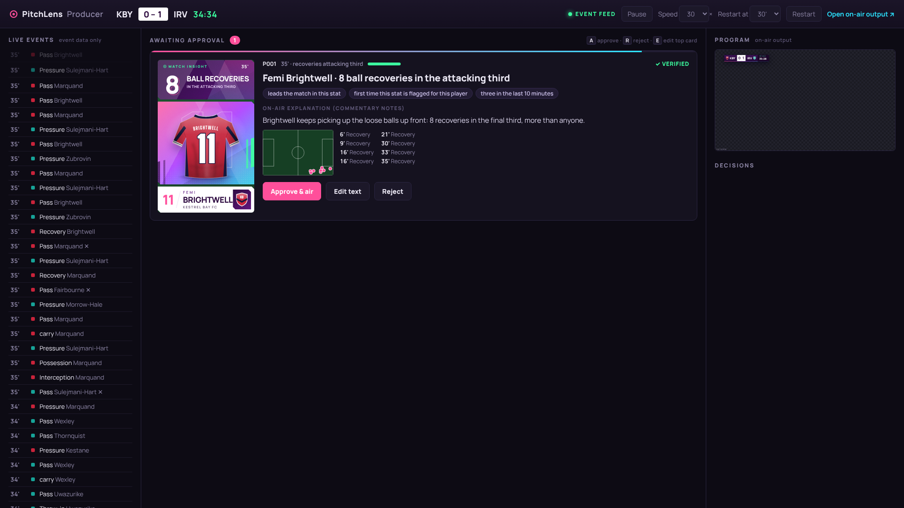
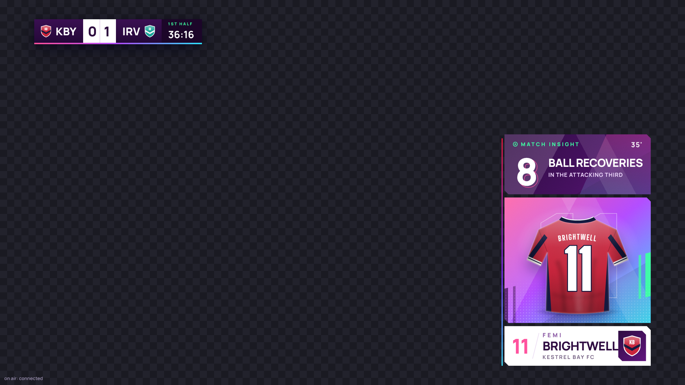
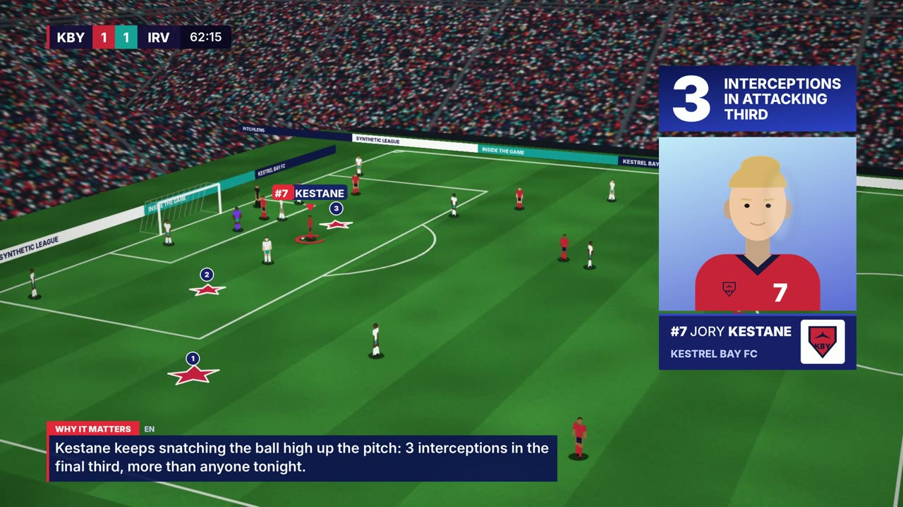
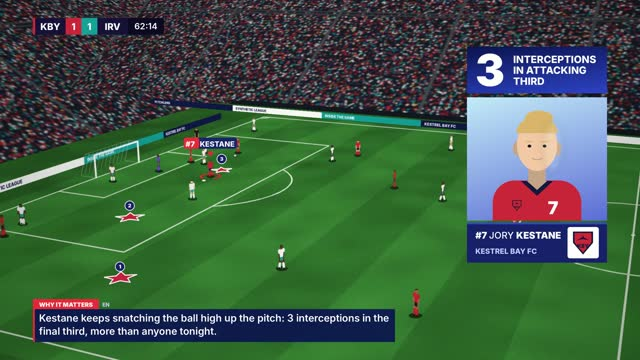
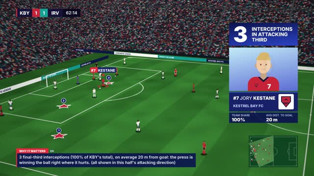
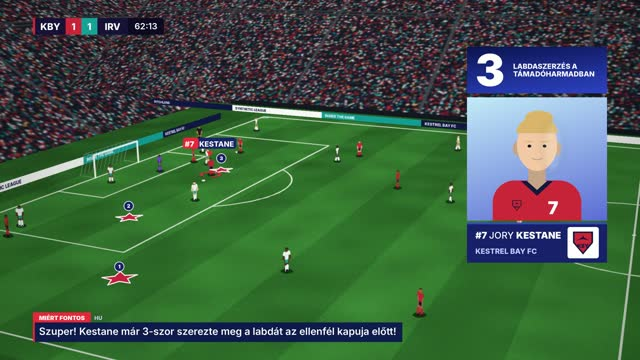
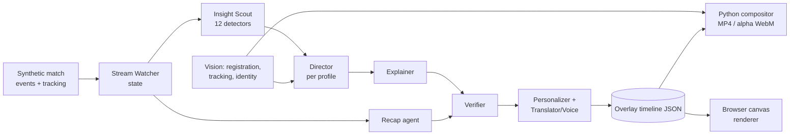
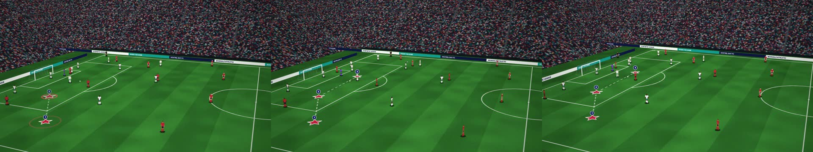
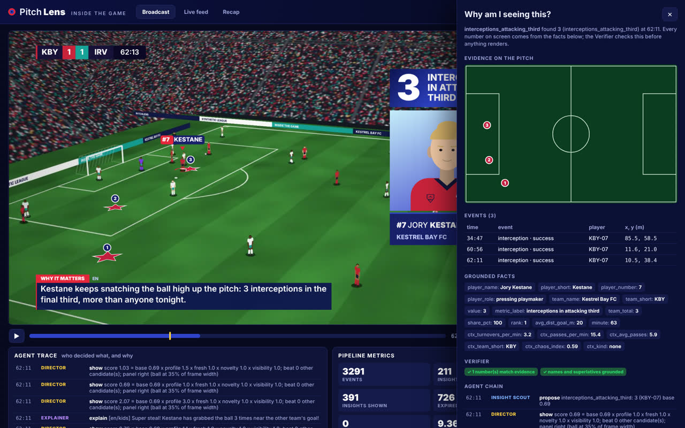
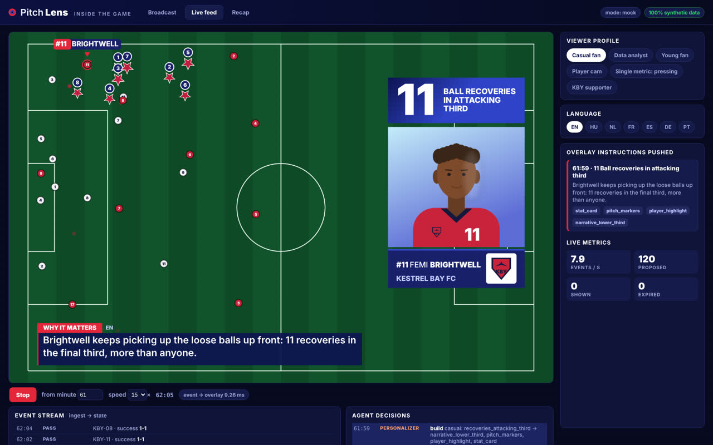

# PitchLens: agentic insight overlays for football broadcasts

> *Inside the Game* developer hackathon submission. **100% synthetic data, synthetic footage, fictional clubs.**

PitchLens watches a match's event stream, decides **which stat is worth showing right now**, explains **why it matters**, and draws the evidence **on the pitch inside the video**, glued to the grass while the camera pans. The same intelligence becomes six different viewer experiences in seven languages, and every number on screen can be traced back to the events behind it.

## The producer workflow (start here)

**Event data in, an AI analyst watches it, a human approves, the graphic airs.**

1. The live **event feed** (passes, tackles, interceptions, shots...) streams in. No video is needed.
2. The **analyst agent** keeps a rolling match state and flags only *outstanding* player moments: someone who leads the match in a stat, owns most of the team's total, or produced a genuinely big chance or pass. That is about 7 proposals in 90 minutes, not 100.
3. Each proposal **pops up in the producer console** with a preview of the exact on-air graphic, why the agent flagged it, the verified explanation for commentary, and the events behind it on a mini pitch.
4. The producer presses **A** (approve), **R** (reject) or **E** (edit). Edited text is re-checked by the Verifier while typing. Stale proposals expire on their own.
5. Approved graphics play on the **on-air output**, a transparent 1920x1080 page that any vision mixer can use as a browser source.

```bash
uvicorn pitchlens.api.app:app --port 8000
# producer console:  http://localhost:8000/producer
# on-air output:     http://localhost:8000/onair        (?bg=1 for a preview background)
```

| Producer console | On-air output (approved card) |
|---|---|
|  |  |

The rest of this README describes the R&D track: the same agents driving fully automatic, pitch-anchored overlays on video.



| Casual fan | Data analyst | Hungarian, young fan |
|---|---|---|
|  |  |  |

## 5-minute quickstart

```bash
python -m venv .venv && . .venv/bin/activate
pip install -e ".[dev]"

# 1. Generate the deterministic synthetic match (fictional clubs, events + 10 Hz tracking)
python -m pitchlens.synth.generate --seed 6 --narrative late_comeback --out data/synthetic/demo

# 2. Build the demo bundle: synthetic footage -> vision -> agents -> overlays (~6 min CPU, cached)
python scripts/build_demo.py

# 3. Run the app
uvicorn pitchlens.api.app:app --port 8000      # open http://localhost:8000/producer
pytest                                          # 58 tests incl. grounding eval, golden images, latency budget
```

No API keys needed: everything runs in **mock mode** with deterministic, grounded fallbacks. To use Azure, copy `.env.example` to `.env`, set `PITCHLENS_MODE=azure` and fill in the services you want. Missing ones fall back silently. Docker: `docker compose up --build`. Azure: `azd up` (see [docs/AZURE_DEPLOY.md](docs/AZURE_DEPLOY.md)).

## How this maps to the five-stage brief

| Stage | What PitchLens does | Where |
|---|---|---|
| **1. Ingest** | Synthetic events (passes, shots, tackles, interceptions, pressures, possession changes, set pieces, subs, metadata) + 10 Hz tracking, as file replay, paced live stream (WebSocket) or Azure Event Hubs | `synth/`, `ingest/`, `azure/eventhubs.py` |
| **2. Interpret** | Rolling `MatchState`: possession sequences, zones, PPDA, field tilt, xG momentum, turnover rate, sprints/top speed/distance. 12 detectors produce insight candidates with evidence (event ids + pitch coordinates + facts) | `state/`, `insights/` |
| **3. Explain** | Director (what/when/where, per profile), Explainer (control vs chaos, tempo, pressure context), Verifier (grounding), all traced | `agents/` |
| **4. Render** | Versioned overlay-timeline JSON with media-clock timing and pitch-space geometry, drawn by a Python broadcast compositor (burn-in MP4, alpha WebM, PNG) and a browser canvas renderer through per-frame homographies | `schema/overlay.py`, `render/`, `web/overlay.js`, `vision/` |
| **5. Personalize** | Casual, analyst, young fan, player cam, single metric, favourite club; 7 languages (EN HU NL FR ES DE PT); TTS-ready SSML; automated recap | `personalize/`, `narrative/`, `agents/recap.py` |

Brief bonus items covered: player name tags with speed chips on thresholds; pass quality (distance, difficulty, accuracy, ball speed); shot speed; auto-eventing from video (`vision_estimated` passes/turnovers, reconciled with the dataset); narratives and recaps; explainability; synthetic-dataset innovation (agent-based sim with storylines); multilingual storytelling.

## Architecture



The full diagram and component notes are in [docs/ARCHITECTURE.md](docs/ARCHITECTURE.md). Decisions and trade-offs are in [docs/DECISIONS.md](docs/DECISIONS.md).

### The agents

| Agent | Responsibility |
|---|---|
| **Stream Watcher** | Ingests events and tracking ticks, maintains match state |
| **Insight Scout** | Runs detectors such as *N interceptions in attacking third*, pass of the match, big chance, control spell, chaos spike, pressing surge (PPDA), xG momentum swing, sprints/top speed and passing milestones |
| **Director** | Scores candidates (`base x profile x freshness x novelty x on-screen visibility`); enforces screen budget, cooldowns and *never cover key action*; can **preempt** a card for a much bigger story; puts the panel opposite the ball |
| **Explainer** | Writes the why-it-matters line from facts only (Azure OpenAI or templates) and adds control/chaos/tempo context |
| **Verifier** | Every number, name and superlative must be in the evidence, or the line is replaced |
| **Personalizer** | Same insight, different overlay set, density, register and chips per profile |
| **Translator / Voice** | Native templates in 7 languages; Azure Translator for free text; Azure Speech SSML/TTS |
| **Recap** | Comeback-aware headline, key moments, player of the match with evidence, tactical story |

Open the UI and press **"Why am I seeing this?"** on any overlay to see its evidence on a pitch map, the grounded facts, the Verifier checks and the agent chain.

## Microsoft / Azure services used

| Service | Used for | Local fallback |
|---|---|---|
| **Azure OpenAI (Azure AI Foundry)** | Explainer and Recap agents; typed tools exported as function schemas | Grounded locale templates |
| **Azure AI Translator** | Translating free-form LLM text, then re-verified | Native templates per language |
| **Azure AI Speech** | Neural TTS of the narrative line (SSML, 7 voices) | SSML files only |
| **Azure Event Hubs** | Live match-event ingest | `LiveSource` (paced replay) |
| **Azure Web PubSub** | Fan-out of overlay instructions per profile | In-process WebSocket hub |
| **Azure Blob Storage** | Rendered clips, alpha streams, recap cards | `outputs/` |
| **Azure Container Apps** + **azd/Bicep** | Hosting the API and UI | `uvicorn` / Docker |
| **GitHub Actions** | Lint, schema drift, tests incl. grounding eval, Docker build | n/a |

## Measured results (demo bundle, CPU, 1080p)

Produced by `scripts/build_demo.py` + `scripts/eval_bundle.py` (written to `outputs/demo/metrics.json`). Ground truth exists only because the footage is synthetic: the renderer exports its true camera and boxes, and the vision stack never reads them.

| | |
|---|---|
| Pitch registration vs true camera (30 s pan, one simulated 8-point manual calibration with 1.5 px click noise) | **0.9 px mean, 2.2 px max** reprojection error |
| Evidence-marker glue error (marker centres, estimated vs true camera) | **1.3 px mean, 3.4 px max** |
| Player detection precision / recall | 0.96 / 0.81 |
| Identity accuracy (tracks -> dataset players) | 89% of matched boxes |
| Vision-estimated passes vs dataset passes (30 s clip) | precision 1.0, recall 0.38 (labelled *estimated*) |
| Event -> overlay decision latency (mock mode) | **~9 ms p99** (budget 1 s) |
| Full 90' match through all agents, 6 profiles x 7 languages | ~5 s |



| Why am I seeing this? (evidence drawer) | Live feed: the same overlay JSON drawn on a tactical pitch |
|---|---|
|  |  |

### On a real broadcast clip (local development only)

The same engine ran on a real 30 s tactical-camera clip that stays local (never committed or published). It used 5 manual keyframe calibrations. In leave-one-out checks against held-out manual calibrations, registration was 3-5 px off on well-covered stretches; the wide zoom-out needs its own keyframe. Evidence markers stayed glued through the zoom-out and the panel/ring/lower third rendered as on synthetic footage. Details and limits: [docs/REAL_CLIPS.md](docs/REAL_CLIPS.md).

## Demo video

`python scripts/make_demo_video.py` assembles the < 2 min submission video (`outputs/submission/pitchlens_demo.mp4`, ~93 s) from rights-clear material only. The script and voice-over are in [docs/DEMO_SCRIPT.md](docs/DEMO_SCRIPT.md); the elevator pitch is in [docs/PITCH.md](docs/PITCH.md).

## Repository layout

```
src/pitchlens/
  schema/      pydantic contracts (+ JSON Schema export -> docs/schema)
  synth/       agent-based match simulator, fictional squads, narratives
  ingest/      replay + live sources
  state/       rolling match state and rhythm metrics
  insights/    detectors, evidence orientation
  agents/      watcher, scout, director, explainer, verifier, recap, orchestrator
  narrative/   locale templates (en hu nl fr es de pt)
  personalize/ viewer profiles, overlay producer
  vision/      camera model, pitch model, registration, detection, tracking, auto-events
  footage/     rights-clear synthetic broadcast footage renderer
  render/      design tokens, generated assets, compositor, video export
  api/         FastAPI + WebSocket live feed
  azure/       thin Azure adapters with mocks
web/           broadcast viewer, live feed, recap (plain JS; canvas overlay renderer)
scripts/       build_demo, demo video, diagnostics, evaluation
docs/          ARCHITECTURE, DECISIONS, DATA_CARD, PITCH, DEMO_SCRIPT, REAL_CLIPS, AZURE_DEPLOY, SCHEMA, schema/
infra/         Bicep for Azure Container Apps + AI services (azure.yaml for azd)
```

## Compliance

* All clubs, players, venues, competitions, crests and portraits are fictional and generated in this repo. Fonts are Inter, Manrope and Big Shoulders Display (SIL OFL, `assets/fonts/OFL.txt`, `web/broadcast/fonts/OFL-*.txt`). The broadcast theme is an original identity, not a copy of any real league's.
* Real broadcast clips may be used **locally** for development (`docs/REAL_CLIPS.md`). They are git-ignored, blocked by a pre-commit hook, and never used in the demo video.
* No secrets in the repo: see `.env.example`.

## Limitations

Stated plainly in [docs/DATA_CARD.md](docs/DATA_CARD.md) and [docs/DECISIONS.md](docs/DECISIONS.md). In short: the simulator is plausible, not a physics engine; vision metrics are measured on synthetic footage; the colour-blob detector expects a tactical camera and kits that contrast with the grass; vision-estimated events are labelled *estimated*.

MIT licence.
