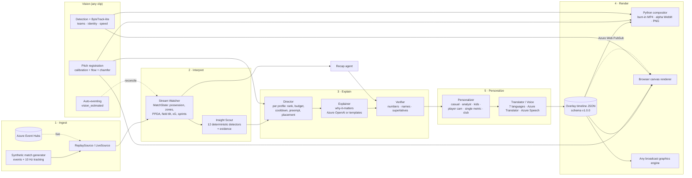

# Architecture

PitchLens is a pipeline of small, typed stages. One **shared interpretation** of the match feeds **any number of viewer experiences**. Each experience then goes to **any renderer** through a single JSON contract.

## Contracts (`src/pitchlens/schema`, exported to `docs/schema/*.schema.json`)

| Contract | Producer -> consumer | Notes |
|---|---|---|
| `MatchMeta`, `Event` | generator / Event Hubs -> watcher | One flat, typed event model. `pass_info` / `shot_info` sub-models. `source: synthetic \| vision_estimated` |
| `InsightCandidate` | scout -> director | `evidence.facts` holds **every number and name** the text layer may use |
| `Decision`, `AgentTrace` | director, all agents -> UI | Each decision carries its scoring formula and reason |
| `OverlayTimeline` | personalizer -> renderers | Media-clock timing, pitch-space geometry (m), text per language, style tokens, grounding |
| `CameraTrack` | registration -> renderers | Per-frame pitch->image homography + quality |
| `ScreenTracks` | vision -> renderers | Identified player boxes, pitch xy, speed |

The renderer never sees events or state, only the timeline, camera and tracks. That's why the Python compositor, the browser canvas renderer and a third-party graphics engine can all consume the same output.

## Agents (`src/pitchlens/agents`)

| Agent | Job | Deterministic fallback | Azure / LLM path |
|---|---|---|---|
| Stream Watcher | Maintains `MatchState` incrementally (events + tracking ticks) | n/a (always exact) | Event Hubs consumer |
| Insight Scout | Runs 12 detectors, emits candidates with evidence | n/a (always exact) | n/a |
| Director | Picks what, when, how long and where, per profile: score = base x profile x freshness x novelty x visibility. Screen budget, cooldowns, key-action hold, **preemption**, panel placement opposite the ball | rules | tools exposed as OpenAI function schemas (`ToolRegistry.schemas()`) |
| Explainer | "Why it matters" with control/chaos/tempo context from `get_rhythm` | locale templates | Azure OpenAI (JSON mode), facts-only prompt |
| Verifier | Rejects ungrounded numbers, names and superlatives. Falls back to templates | rules | n/a (always rules) |
| Personalizer | Builds overlay items per profile: density, visuals, register, chips, speed thresholds | rules | n/a |
| Translator / Voice | Native templates in 7 languages, SSML | templates, SSML files | Azure AI Translator, Azure AI Speech |
| Recap | Headline (comeback detection), moments, player of the match with evidence, tactical story | templates | Azure OpenAI (optional) |

Every call is logged as an `AgentTrace`: agent, match time, action, summary, structured output, latency, and the insight it belongs to. The UI's *Why am I seeing this?* drawer is a filtered view of these traces plus the evidence events.

## Vision (`src/pitchlens/vision`)

1. **Registration.** Start from a manual keyframe calibration (>= 4 clicks). Propagate with LK optical flow on ground-plane features only (players, stands and graphics masked) and an inter-frame homography by RANSAC. Then apply **chamfer refinement**: 8 anchor offsets solved by robust least squares on the truncated distance transform of detected line pixels, coarse-to-fine. Finally, zero-phase temporal smoothing of the pitch positions of 4 image anchors.
2. **Detection.** `ColorBlobDetector` segments non-grass blobs on the projected pitch, removes paint with morphology, and splits merged blobs by the expected player size from H. The ball detector masks projected lines and the goal volume. `UltralyticsDetector` is optional.
3. **Tracking.** ByteTrack-style two-stage association in **pitch metres** (camera motion removed), with Hungarian matching and gates that grow with time lost.
4. **Teams and identity.** Jersey-colour k-means in Lab, with outliers (GK/referee) set to `other`. Identity comes from Hungarian matching against dataset positions plus a majority vote, or from an anchor map for real clips.
5. **Auto-eventing.** Ball-possession runs give estimated passes and turnovers with ball speed and confidence. These are reconciled with synthetic passes (precision/recall).

## Performance (CPU, 4 cores, 1080p)

See `outputs/demo/metrics.json` after `scripts/build_demo.py`. Typical figures:

* Full 90-minute match through all agents for 6 profiles x 7 languages: ~5 s. Event->decision p99 ~9 ms (budget: 1 s).
* Registration accuracy on the demo clip: 2.0 px mean / 3.5 px max vs the true camera. Marker glue error: 1.3 px mean.
* Registration ~12 fps, detection + tracking ~25 fps, overlay compositing + H.264 encode ~13 fps. The overlay layer alone renders faster than real time. Every stage is cached.
